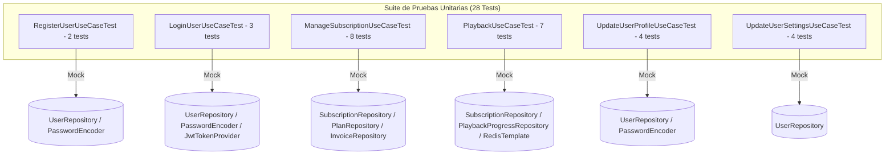

# Reporte de Pruebas Unitarias — Backend Sistema VOID (`void-spring`)

**Fecha de Ejecución:** 27 de Octubre de 2026  
**Ingeniero QA / Desarrollador:** QA Automation & Senior Java Backend Engineer  
**Entorno de Pruebas:**
- **JDK:** OpenJDK 21 (Eclipse Adoptium)
- **Framework:** Spring Boot 3.2.5
- **Testing Core:** JUnit 5 (Jupiter), Mockito 5 (`MockitoExtension`), AssertJ
- **Total de Pruebas:** 28
- **Estado General:** ✅ **100% Exitoso (28 Passed, 0 Failed, 0 Skipped)**
- **Tiempo de Ejecución:** ~14.0 segundos

---

## 1. Estrategia y Enfoque de Pruebas

Para garantizar pruebas de alta fidelidad, independientes y de ejecución ultrarrápida (menos de 15 segundos para toda la suite), se utilizó una estrategia de **pruebas unitarias puras y aisladas**:

1. **Aislamiento Total del Contexto Spring:**
   - Se prescindió de `@SpringBootTest` para evitar levantar el contenedor de IoC, conexiones a bases de datos o brokers en memoria.
   - Se utilizó `@ExtendWith(MockitoExtension.class)` junto con `@Mock` y `@InjectMocks`.

2. **Verificación de Invariantes y Contratos de Dominio:**
   - Se validaron tanto los caminos de éxito (**Happy Path**) como las violaciones de reglas de negocio (**Negative Paths** / Excepciones de Dominio).
   - Se emplearon `ArgumentCaptor` para inspeccionar el estado exacto de las entidades antes de ser persistidas (`User`, `UserSettings`, `Invoice`, `Subscription`, `PlaybackProgress`).
   - Se verificó la no ejecución de efectos colaterales ante errores (ej. que no se intente hashear contraseñas ni guardar en base de datos si el correo ya existe).



---

## 2. Detalle de Casos de Prueba por Componente

### 2.1. `RegisterUserUseCaseTest` (2 Pruebas)
Prueba la lógica de registro de usuarios, cifrado de contraseñas y aprovisionamiento de configuración inicial.

| # | Nombre de la Prueba | Escenario y Validaciones | Resultado |
|---|--------------------|--------------------------|:---------:|
| 1 | `shouldRegisterUserSuccessfully` | Verifica que un nuevo usuario sea persistido con su contraseña hasheada, rol `USER`, y un registro `UserSettings` asociado por defecto (`language="es"`, `theme="dark"`, `autoplay=true`, `notifications=true`). Retorna `LoginResponse.UserDto` con su UUID asignado. | ✅ PASS |
| 2 | `shouldThrowDuplicateEmailErrorWhenEmailAlreadyExists` | Comprueba que si el email ya existe en `userRepository.findByEmail`, se interrumpa la ejecución arrojando `DuplicateEmailError` sin invocar el codificador de contraseñas ni el método `save()`. | ✅ PASS |

---

### 2.2. `LoginUserUseCaseTest` (3 Pruebas)
Prueba la autenticación de credenciales y emisión de tokens seguros.

| # | Nombre de la Prueba | Escenario y Validaciones | Resultado |
|---|--------------------|--------------------------|:---------:|
| 3 | `shouldLoginSuccessfully` | Valida que ante credenciales correctas (`passwordEncoder.matches == true`), se genere y devuelva el token JWT correspondiente con los claims del usuario y su rol. | ✅ PASS |
| 4 | `shouldThrowUserNotFoundErrorWhenUserDoesNotExist` | Comprueba que si el email no existe en base de datos, se arroje `UserNotFoundError("Credenciales inválidas")` sin llamar al encoder de contraseñas. | ✅ PASS |
| 5 | `shouldThrowInvalidCredentialsErrorWhenPasswordIsIncorrect` | Valida que si la contraseña provista no coincide con el hash almacenado, se arroje `InvalidCredentialsError` y nunca se emita un token JWT. | ✅ PASS |

---

### 2.3. `ManageSubscriptionUseCaseTest` (8 Pruebas)
Prueba la gestión de ciclo de vida de suscripciones, emisión de facturas (`Invoice`), cálculo de prorrata en cambios de plan y cancelaciones.

#### Submódulo: `subscribeInitial`
| # | Nombre de la Prueba | Escenario y Validaciones | Resultado |
|---|--------------------|--------------------------|:---------:|
| 6 | `shouldSubscribeInitialSuccessfully` | Verifica la suscripción inicial cuando no existe suscripción activa: crea `Subscription` en estado `ACTIVE` con vigencia de 30 días y genera una factura idempotente (`Invoice`) en estado `SUCCEEDED` por el monto y moneda del plan. | ✅ PASS |
| 7 | `shouldThrowActiveSubscriptionExistsErrorWhenAlreadyHasActive` | Asegura que un usuario con suscripción activa no pueda crear una segunda suscripción simultánea, lanzando `ActiveSubscriptionExistsError`. | ✅ PASS |
| 8 | `shouldThrowUserNotFoundErrorWhenPlanNotFoundOrInactive` | Valida que si el `planId` no existe o tiene `isActive = false`, se lance `UserNotFoundError` sin persistir suscripción ni factura. | ✅ PASS |

#### Submódulo: `changePlan`
| # | Nombre de la Prueba | Escenario y Validaciones | Resultado |
|---|--------------------|--------------------------|:---------:|
| 9 | `shouldApplyUpgradeSuccessfully` | Evalúa el escenario de **Upgrade**: al pasar a un plan de mayor costo, se calcula la prorrata sobre el tiempo no consumido del período actual, se emite una factura con motivo `UPGRADE_PRORATION` y el cambio se aplica de inmediato (`UPGRADE_APPLIED`). | ✅ PASS |
| 10 | `shouldScheduleDowngradeSuccessfully` | Evalúa el escenario de **Downgrade**: al pasar a un plan de menor costo, no se cobra penalización ni se cambia el plan actual inmediatamente; se programa el cambio registrando `pendingDowngradePlanId` para el fin del período (`DOWNGRADE_SCHEDULED`). | ✅ PASS |
| 11 | `shouldThrowWhenNoActiveSubscriptionForChangePlan` | Comprueba que intentar cambiar de plan sin una suscripción activa previa lance `UserNotFoundError`. | ✅ PASS |

#### Submódulo: `cancelAutoRenewal`
| # | Nombre de la Prueba | Escenario y Validaciones | Resultado |
|---|--------------------|--------------------------|:---------:|
| 12 | `shouldCancelAutoRenewalSuccessfully` | Comprueba la cancelación voluntaria de auto-renovación: marca `cancelAtPeriodEnd = true`, asigna timestamp en `canceledAt`, y conserva el acceso del usuario hasta `currentPeriodEnd`. | ✅ PASS |
| 13 | `shouldThrowWhenNoActiveSubscriptionToCancel` | Lanza `UserNotFoundError` si no existe una suscripción activa sobre la cual cancelar la renovación. | ✅ PASS |

---

### 2.4. `PlaybackUseCaseTest` (7 Pruebas)
Prueba la autorización de streaming concurrente mediante estructuras de datos Redis (Sorted Sets / `ZSet`) y el control del progreso de reproducción.

#### Submódulo: `authorizePlaybackSession`
| # | Nombre de la Prueba | Escenario y Validaciones | Resultado |
|---|--------------------|--------------------------|:---------:|
| 14 | `shouldAuthorizeSessionSuccessfully` | Autoriza la reproducción cuando el conteo de streams activos es menor al `maxConcurrentStreams` del plan. Limpia sesiones inactivas por heartbeat, registra la sesión en Redis ZSet y configura TTL de 120s. | ✅ PASS |
| 15 | `shouldReturnPreviousProgressWhenAvailable` | Verifica que si el usuario ya tenía progreso guardado para el video, la autorización devuelva el tiempo exacto en segundos (`resumePositionSeconds`) para reanudar la reproducción. | ✅ PASS |
| 16 | `shouldAllowExistingSessionEvenIfCountIsAtMax` | Valida que si una sesión ya registrada renueva su autorización (heartbeat periódico), no sea bloqueada aunque el número de conexiones haya llegado al límite máximo. | ✅ PASS |
| 17 | `shouldThrowConcurrentStreamLimitExceededErrorWhenLimitReached` | Verifica que cuando una nueva sesión intenta reproducir pero ya se alcanzó el límite de pantallas del plan, se lance `ConcurrentStreamLimitExceededError` impidiendo el registro en Redis. | ✅ PASS |

#### Submódulo: `syncProgress`
| # | Nombre de la Prueba | Escenario y Validaciones | Resultado |
|---|--------------------|--------------------------|:---------:|
| 18 | `shouldCreateNewProgressNotCompleted` | Valida la creación inicial de progreso cuando no existía registro previo, marcando `completed = false` si el tiempo es inferior al 95%. | ✅ PASS |
| 19 | `shouldMarkCompletedWhenPositionIsAtLeast95Percent` | Comprueba la regla de negocio del 95%: si el usuario avanza hasta al menos el 95% de la duración total (ej. 95 de 100 segundos), el registro se marca automáticamente con `completed = true`. | ✅ PASS |
| 20 | `shouldUpdateExistingProgress` | Actualiza la posición y duración de un registro de progreso preexistente en base de datos. | ✅ PASS |

---

### 2.5. `UpdateUserProfileUseCaseTest` (4 Pruebas)
Prueba la actualización de datos de perfil, validaciones de unicidad de email y actualización de credenciales.

| # | Nombre de la Prueba | Escenario y Validaciones | Resultado |
|---|--------------------|--------------------------|:---------:|
| 21 | `shouldUpdateProfileSuccessfully` | Actualiza nombre completo, dirección de correo electrónico y contraseña (hasheada correctamente) en una sola operación. | ✅ PASS |
| 22 | `shouldUpdateOnlyNameWhenEmailAndPasswordAreNotProvided` | Comprueba que una actualización parcial que solo provea el nombre modifique únicamente dicho campo, sin intentar hashear ni alterar el email o password existente. | ✅ PASS |
| 23 | `shouldThrowUserNotFoundErrorWhenUserDoesNotExist` | Lanza `UserNotFoundError` si el UUID provisto no corresponde a un usuario registrado. | ✅ PASS |
| 24 | `shouldThrowDuplicateEmailErrorWhenEmailAlreadyInUse` | Impide que un usuario cambie su correo electrónico por uno que ya pertenezca a otra cuenta, arrojando `DuplicateEmailError`. | ✅ PASS |

---

### 2.6. `UpdateUserSettingsUseCaseTest` (4 Pruebas)
Prueba la actualización granular de preferencias de reproducción e interfaz.

| # | Nombre de la Prueba | Escenario y Validaciones | Resultado |
|---|--------------------|--------------------------|:---------:|
| 25 | `shouldUpdateExistingSettingsSuccessfully` | Actualiza de forma exitosa los atributos de idioma (`language`), tema visual (`theme`), notificaciones y reproducción automática (`autoplay`). | ✅ PASS |
| 26 | `shouldInitializeSettingsIfUserHadNone` | Valida la inicialización resiliente: si la relación `settings` del usuario era `null`, crea y enlaza una nueva entidad `UserSettings`. | ✅ PASS |
| 27 | `shouldKeepPreviousValuesWhenFieldsAreNull` | Asegura que si se envían valores nulos en el request (ej. solo se desea cambiar el idioma), las preferencias existentes no se sobreescriban ni se pierdan. | ✅ PASS |
| 28 | `shouldThrowUserNotFoundErrorWhenUserDoesNotExist` | Lanza `UserNotFoundError` si el usuario consultado no existe. | ✅ PASS |

---

## 3. Log de Ejecución Maven (`Surefire Report`)

```text
[INFO] -------------------------------------------------------
[INFO]  T E S T S
[INFO] -------------------------------------------------------
[INFO] Running com.voidapp.core.application.usecase.LoginUserUseCaseTest
[INFO] Tests run: 3, Failures: 0, Errors: 0, Skipped: 0, Time elapsed: 3.140 s
[INFO] Running com.voidapp.core.application.usecase.ManageSubscriptionUseCaseTest
[INFO] Tests run: 8, Failures: 0, Errors: 0, Skipped: 0, Time elapsed: 0.560 s
[INFO] Running com.voidapp.core.application.usecase.PlaybackUseCaseTest
[INFO] Tests run: 7, Failures: 0, Errors: 0, Skipped: 0, Time elapsed: 0.802 s
[INFO] Running com.voidapp.core.application.usecase.RegisterUserUseCaseTest
[INFO] Tests run: 2, Failures: 0, Errors: 0, Skipped: 0, Time elapsed: 0.060 s
[INFO] Running com.voidapp.core.application.usecase.UpdateUserProfileUseCaseTest
[INFO] Tests run: 4, Failures: 0, Errors: 0, Skipped: 0, Time elapsed: 0.024 s
[INFO] Running com.voidapp.core.application.usecase.UpdateUserSettingsUseCaseTest
[INFO] Tests run: 4, Failures: 0, Errors: 0, Skipped: 0, Time elapsed: 0.017 s
[INFO] 
[INFO] Results:
[INFO] 
[INFO] Tests run: 28, Failures: 0, Errors: 0, Skipped: 0
[INFO] 
[INFO] ------------------------------------------------------------------------
[INFO] BUILD SUCCESS
[INFO] ------------------------------------------------------------------------
```

---

## 4. Cómo Ejecutar las Pruebas

Para volver a ejecutar toda la suite de pruebas unitarias en cualquier momento desde la terminal:

```powershell
cd void-spring
mvn test
```

Para ejecutar una clase de prueba específica:
```powershell
mvn test -Dtest=PlaybackUseCaseTest
```

